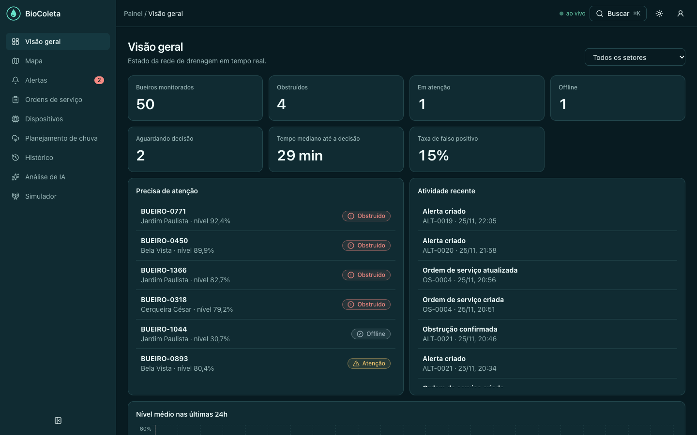
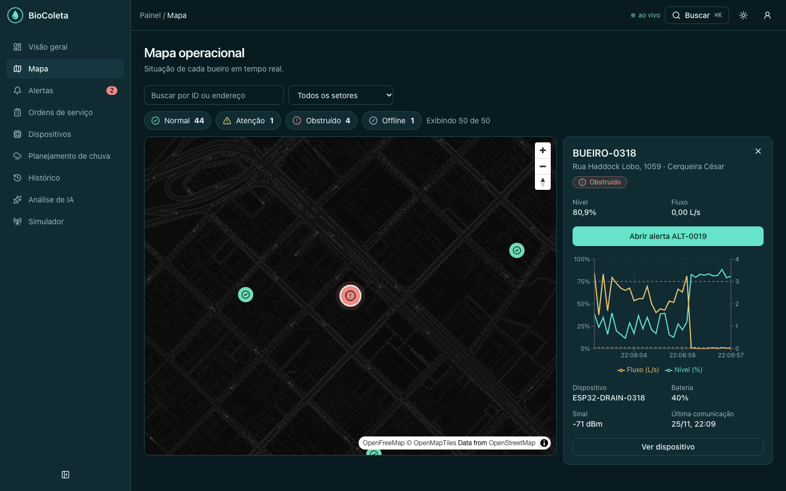
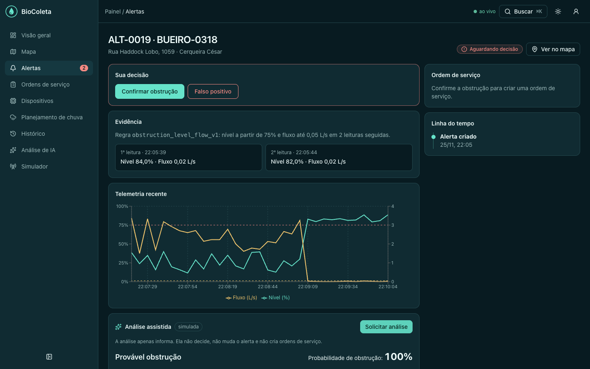
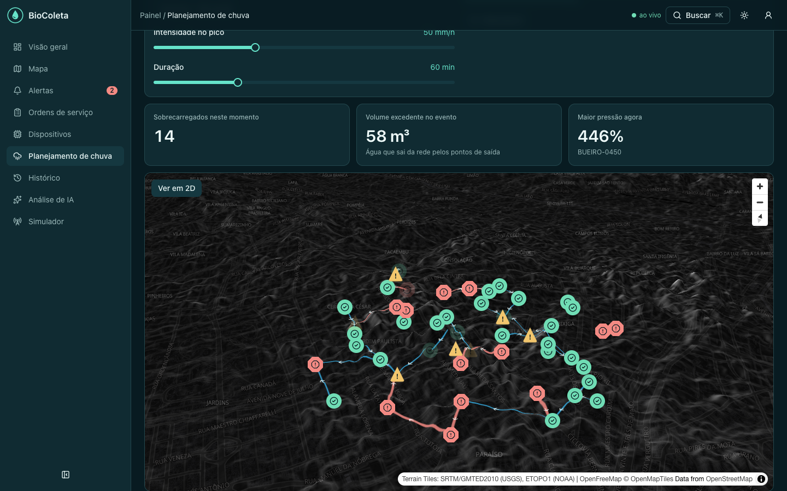

  

<h3 align="center">Veja o risco antes que a água vire problema.</h3>

  <a href="https://biocoleta.github.io/biocoleta/"><strong>Abrir o MVP</strong></a> ·
  <a href="https://biocoleta.github.io/biocoleta/simulator">Testar o simulador</a> ·
  <a href="https://github.com/BioColeta/biocoleta">Código</a> ·
  <a href="https://github.com/BioColeta/biocoleta/blob/main/docs/BioColeta.md">Documento de visão</a>

> **Projeto acadêmico.** Sensores, telemetria, autenticação e análise de IA são simulados no navegador. Só a altitude dos bueiros vem de dados reais de terreno, e o planejamento de chuva é uma estimativa didática que não prevê alagamentos reais.

## O problema

Falhas na drenagem urbana costumam ser percebidas só quando a rua já alagou, com transtornos, danos ao patrimônio e riscos à saúde. Sem monitoramento contínuo, as equipes não conseguem agir antes.

## Como funciona

1. **O dispositivo envia** o nível da água e o fluxo de cada bueiro.
2. **O sistema identifica** a obstrução com uma regra fixa: nível alto e água parada em duas leituras seguidas.
3. **Uma pessoa decide:** o operador analisa as evidências, confirma e programa a limpeza.
4. **A telemetria encerra** o alerta quando o escoamento volta ao normal.

## O que há no MVP

| Visão geral | Mapa operacional |
|---|---|
|  |  |
| **Alerta e decisão** | **Planejamento de chuva** |
|  |  |

Também há ordens de serviço em quadro kanban, inventário de dispositivos, simulador de cenários, histórico de auditoria e análise assistida simulada.

## Tecnologias

React · TypeScript · Vite · Tailwind CSS · TanStack · MapLibre · Recharts · MSW · Vitest · Playwright · GitHub Actions e Pages

## Objetivos de Desenvolvimento Sustentável

| ODS 6 | ODS 11 | ODS 12 | ODS 13 |
|---|---|---|---|
| Água potável e saneamento | Cidades e comunidades sustentáveis | Consumo e produção responsáveis | Ação contra a mudança do clima |

## Equipe

Hadrian · César · Jerônimo · Miguel · Rafael · Victor
